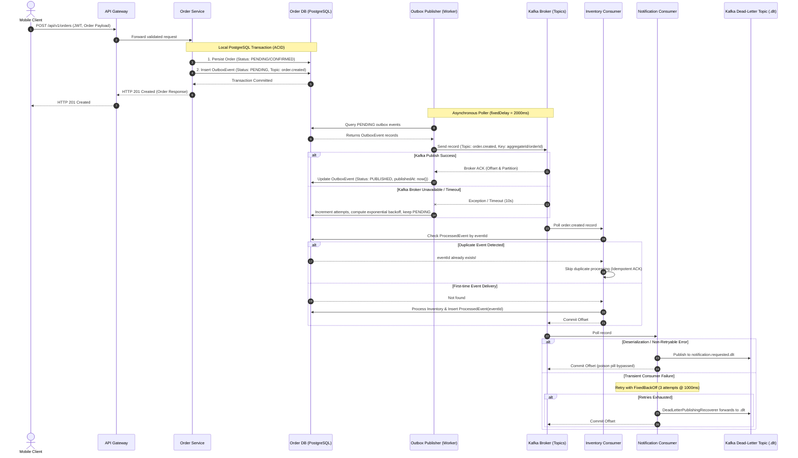

# Event-Driven Architecture: Event Contracts and Topic Design

This document specifies the event contracts, topic topology, producer/consumer boundaries, transactional consistency guarantees, and schema evolution rules for the Mobile Commerce Microservices backend.

---

## 1. Architecture Overview

The system uses an **Event-Driven Architecture** built on Apache Kafka, Spring Boot Microservices, and PostgreSQL. It implements the **Transactional Outbox Pattern** to decouple local database transactions from asynchronous Kafka publishing, ensuring at-least-once delivery without distributed two-phase commits.



---

## 2. Standard Event Envelope Specification

Every domain event published to Kafka is packaged inside a versioned, strongly-typed generic envelope (`EventEnvelope<T>`):

| Field | Type | Required | Description | Example |
|---|---|---|---|---|
| `eventId` | `String` (UUID) | **Yes** | Globally unique identifier generated by the producer. Used for consumer idempotency and deduplication. | `"4a65b7c8-9d0e-4f1a-b2c3-d4e5f6a7b8c9"` |
| `eventType` | `String` | **Yes** | Canonical event name matching `EventTypes` constants. | `"ORDER_CREATED"` |
| `schemaVersion` | `String` | **Yes** | Semantic version of the payload contract (`MAJOR.MINOR`). | `"1.0"` |
| `occurredAt` | `Instant` (UTC) | **Yes** | ISO-8601 UTC timestamp of when the business event actually occurred. | `"2026-10-19T12:00:00Z"` |
| `correlationId` | `String` | **Yes** | Distributed tracing identifier propagated from the incoming HTTP request (`X-Correlation-Id`). | `"corr-a1b2c3d4-e5f6"` |
| `aggregateId` | `String` | **Yes** | Business aggregate identifier used as Kafka message key to guarantee partition ordering. | `"1001"` |
| `payload` | `T` (Object) | **Yes** | Domain-specific event body containing validated business attributes. | `{ ... }` |

### Envelope JSON Structure
```json
{
  "eventId": "f47ac10b-58cc-4372-a567-0e02b2c3d479",
  "eventType": "ORDER_CREATED",
  "schemaVersion": "1.0",
  "occurredAt": "2026-10-19T12:00:00Z",
  "correlationId": "c830b5e2-6291-4cf4-9189-9a70f3f22c81",
  "aggregateId": "501",
  "payload": {
    "orderId": 501,
    "userId": 42,
    "totalAmount": 199.98,
    "status": "CONFIRMED",
    "items": [
      {
        "productId": 10,
        "productName": "Wireless Noise-Canceling Headphones",
        "quantity": 2,
        "unitPrice": 99.99,
        "subtotal": 199.98
      }
    ]
  }
}
```

---

## 3. Event Catalogue & Schema Definitions

### 3.1 `ORDER_CREATED`
- **Topic:** `order.created` (DLT: `order.created.dlt`)
- **Producer:** Order Service
- **Consumers:** Product Service (Inventory), Notification Service, Analytics
- **Message Key:** `orderId` (`aggregateId`)
- **Business Trigger:** User successfully places an order and local payment/reservation is recorded.
- **Payload Schema:**
  - `orderId` (`Long`, required, > 0)
  - `userId` (`Long`, required, > 0)
  - `totalAmount` (`BigDecimal`, required, >= 0.00)
  - `status` (`String`, required, e.g., `"CONFIRMED"`)
  - `items` (`List<OrderItemPayload>`, optional/recommended)

### 3.2 `ORDER_CANCELLED`
- **Topic:** `order.cancelled` (DLT: `order.cancelled.dlt`)
- **Producer:** Order Service
- **Consumers:** Product Service (Inventory Compensation), Notification Service
- **Message Key:** `orderId` (`aggregateId`)
- **Business Trigger:** Order cancelled by customer, administrator, or failed downstream compensation.
- **Payload Schema:**
  - `orderId` (`Long`, required, > 0)
  - `userId` (`Long`, required, > 0)
  - `totalAmount` (`BigDecimal`, required, >= 0.00)
  - `status` (`String`, required, `"CANCELLED"`)
  - `reason` (`String`, optional, cancellation reason)
  - `cancelledAt` (`Instant`, optional, UTC timestamp)

### 3.3 `ORDER_SHIPPED`
- **Topic:** `order.shipped` (DLT: `order.shipped.dlt`)
- **Producer:** Order Service
- **Consumers:** Notification Service, Analytics, Logistics
- **Message Key:** `orderId` (`aggregateId`)
- **Business Trigger:** Order status transitioned from `CONFIRMED` to `SHIPPED` by Admin.
- **Payload Schema:**
  - `orderId` (`Long`, required, > 0)
  - `userId` (`Long`, required, > 0)
  - `totalAmount` (`BigDecimal`, required, >= 0.00)
  - `status` (`String`, required, `"SHIPPED"`)
  - `trackingNumber` (`String`, optional)
  - `carrier` (`String`, optional)

### 3.4 `ORDER_DELIVERED`
- **Topic:** `order.delivered` (DLT: `order.delivered.dlt`)
- **Producer:** Order Service
- **Consumers:** Notification Service, Review & Loyalty Service
- **Message Key:** `orderId` (`aggregateId`)
- **Business Trigger:** Order status transitioned from `SHIPPED` to `DELIVERED` by Admin.
- **Payload Schema:**
  - `orderId` (`Long`, required, > 0)
  - `userId` (`Long`, required, > 0)
  - `totalAmount` (`BigDecimal`, required, >= 0.00)
  - `status` (`String`, required, `"DELIVERED"`)
  - `deliveredAt` (`Instant`, optional, UTC timestamp)

### 3.5 `INVENTORY_UPDATED`
- **Topic:** `inventory.updated` (DLT: `inventory.updated.dlt`)
- **Producer:** Product Service
- **Consumers:** Order Service, Catalog Search Indexer, Analytics
- **Message Key:** `productId` (`aggregateId`)
- **Business Trigger:** Stock quantity reserved, committed, released (compensation), or restocked.
- **Payload Schema:**
  - `productId` (`Long`, required, > 0)
  - `productName` (`String`, optional)
  - `quantityDelta` (`Integer`, required, signed integer: negative for reservation, positive for release)
  - `newStockLevel` (`Integer`, required, >= 0)
  - `operationType` (`String`, required: `"RESERVED"`, `"COMMITTED"`, `"RELEASED"`, `"RESTOCKED"`)
  - `referenceOrderId` (`Long`, optional)

### 3.6 `NOTIFICATION_REQUESTED`
- **Topic:** `notification.requested` (DLT: `notification.requested.dlt`)
- **Producer:** Order Service, User Service
- **Consumers:** Notification Service
- **Message Key:** `recipientUserId` (`aggregateId`)
- **Business Trigger:** System requests dispatch of customer communication (Order confirmation, shipment alert, etc.).
- **Payload Schema:**
  - `recipientUserId` (`Long`, required, > 0)
  - `channel` (`String`, required: `"EMAIL"`, `"SMS"`, `"PUSH"`)
  - `templateId` (`String`, required, e.g. `"ORDER_CONFIRMATION_V1"`)
  - `maskedRecipient` (`String`, optional, e.g., `"u***@example.com"`, `"******1234"` to avoid PII exposure)
  - `templateParameters` (`Map<String, Object>`, optional)

---

## 4. Kafka Topic Topology & Broker Configuration

### 4.1 Topic Catalogue

| Topic Name | Purpose | Producer | Consumer Group | Message Key | Partitions | Retention | Compaction |
|---|---|---|---|---|---|---|---|
| `order.created` | Broadcasts new confirmed orders | Order Service | `order-service-group`, `inventory-group`, `notification-group` | `orderId` | 1 (dev) / 3 (prod) | 7 days (604800000 ms) | delete |
| `order.created.dlt` | Dead-letter queue for order creation | Kafka Recoverer | `dlt-monitoring-group` | `orderId` | 1 | 14 days | delete |
| `order.cancelled` | Order cancellation / Saga compensation | Order Service | `inventory-group`, `notification-group` | `orderId` | 1 (dev) / 3 (prod) | 7 days | delete |
| `order.cancelled.dlt` | DLT for order cancellation | Kafka Recoverer | `dlt-monitoring-group` | `orderId` | 1 | 14 days | delete |
| `order.shipped` | Order shipment events | Order Service | `notification-group`, `analytics-group` | `orderId` | 1 (dev) / 3 (prod) | 7 days | delete |
| `order.shipped.dlt` | DLT for order shipment | Kafka Recoverer | `dlt-monitoring-group` | `orderId` | 1 | 14 days | delete |
| `order.delivered` | Order delivery events | Order Service | `notification-group`, `review-group` | `orderId` | 1 (dev) / 3 (prod) | 7 days | delete |
| `order.delivered.dlt` | DLT for order delivery | Kafka Recoverer | `dlt-monitoring-group` | `orderId` | 1 | 14 days | delete |
| `inventory.updated` | Product stock adjustments & balance | Product Service | `order-service-group`, `catalog-group` | `productId` | 1 (dev) / 3 (prod) | 7 days | delete |
| `inventory.updated.dlt` | DLT for inventory updates | Kafka Recoverer | `dlt-monitoring-group` | `productId` | 1 | 14 days | delete |
| `notification.requested`| Direct notifications queue | Order/User Service | `notification-service-group` | `recipientUserId` | 1 (dev) / 3 (prod) | 3 days | delete |
| `notification.requested.dlt`| DLT for notifications | Kafka Recoverer | `dlt-monitoring-group` | `recipientUserId` | 1 | 14 days | delete |

### 4.2 Broker Configuration & Auto-Creation Policy
In `docker-compose.yml`:
- `KAFKA_AUTO_CREATE_TOPICS_ENABLE: "false"`: Auto-creation is explicitly **disabled** to prevent accidental creation of misconfigured, unkeyed topics.
- Topics are explicitly managed via Spring Boot `@Bean NewTopic` declarations in `KafkaConfig.java` or through administrative deployment scripts.
- In the local development environment, single-broker replication (`replicas = 1`) and `partitions = 1` are configured to match local container resources.

### 4.3 Partitioning & Ordering Guarantees
- Kafka guarantees total order **within a single partition**, but not across multiple partitions.
- By setting the Kafka message key to the aggregate identifier (`orderId` for order lifecycle events, `productId` for inventory events), Kafka's default Murmur2 partitioner hashes identical keys to the exact same partition.
- As a result, `ORDER_CREATED` -> `ORDER_SHIPPED` -> `ORDER_DELIVERED` events for order `1001` are guaranteed to be consumed in strictly chronological order.

---

## 5. Producer, Consumer, and Transaction Boundaries

### 5.1 Local PostgreSQL vs. Kafka Transaction Boundaries
- **Fundamental Rule:** PostgreSQL ACID transactions **do not** automatically encompass Kafka broker operations. A two-phase commit (2PC / XA) across database and message broker is not used due to latency, lock contention, and operational complexity.
- Instead, the **Transactional Outbox Pattern** provides at-least-once delivery:
  1. The business mutation (e.g. `orders` table insert) and the corresponding event publication request (`outbox_events` table insert) execute within the **same local database transaction**.
  2. If the database transaction rolls back, no event is placed into the outbox table.
  3. A background poller (`OutboxEventPublisher`) reads `PENDING` outbox records and publishes them to Kafka with a 10-second synchronous broker ACK (`.get(10, TimeUnit.SECONDS)`).
  4. Only after Kafka confirms persistence (Broker ACK received) is the outbox record updated to `PUBLISHED` (`publishedAt = Instant.now()`).

### 5.2 Outbox Retry & Backoff Mechanics
- If Kafka is temporarily unreachable, the publisher catches the exception:
  - Increments `attempts = attempts + 1`.
  - Calculates exponential backoff: `delaySeconds = Math.min(60L, 1L << attempts)`.
  - Updates `nextAttemptAt = Instant.now() + delaySeconds`.
  - Keeps status as `PENDING`.
- If `attempts >= 5` (`MAX_ATTEMPTS`), the status is updated to `FAILED` and `lastError` contains the truncated stack trace for alert monitoring.

### 5.3 Consumer Idempotency & Deduplication
- Because Kafka guarantees **at-least-once** delivery, network re-transmissions or consumer crashes before committing offsets can result in duplicate event deliveries.
- Every consumer maintains a local deduplication store (`processed_events` table in PostgreSQL):
  1. Consumer inspects `eventId` from the received message.
  2. Checks `processedEventRepository.existsByEventId(eventId)`.
  3. If true, the event is immediately acknowledged and discarded without re-executing business logic.
  4. If false, the consumer performs the business operation and commits `ProcessedEvent(eventId, eventType, processedAt)` in the same transaction.

### 5.4 Error Handling & Dead Letter Topics (DLT)
- Spring Kafka's `DefaultErrorHandler` is configured with:
  - **Retry Policy:** `FixedBackOff(1000L, 3)` (3 attempts with 1-second delay).
  - **Dead Letter Publisher:** `DeadLetterPublishingRecoverer` automatically forwards exhausted messages to `<original-topic>.dlt`.
  - **Fatal Non-Retryable Exceptions:** Deserialization exceptions and `IllegalArgumentException` bypass retries and route directly to DLT.
  - **DLT Replay:** An administrative `DltReplayService` allows operations teams to replay quarantined messages back to the primary topic after bug fixes.

---

## 6. Schema Evolution Rules

To maintain zero-downtime rolling upgrades across microservices:

1. **Forward Compatibility (Tolerant Reader):**
   - All consumer models and payloads are annotated with `@JsonIgnoreProperties(ignoreUnknown = true)`.
   - Consumers safely ignore unknown fields added by newer producer versions.
2. **Backward Compatibility (Default / Optional Fields):**
   - Producers may add new fields to payloads provided they are **optional** or have sane defaults.
   - Required fields must never be removed or renamed in minor schema versions (`1.x`).
3. **Breaking Changes:**
   - Any modification of existing field data types (e.g. changing `orderId` from `Long` to UUID string), removing required fields, or altering semantic meanings requires a **Major Version Bump** (e.g. schema version `"2.0"`).
   - During major migrations, producers dual-publish to versioned topics (e.g. `order.created.v2`) or consumer adapters are deployed before producer updates.
4. **Schema Registry Status:**
   - A centralized Schema Registry (e.g., Confluent Schema Registry / Apicurio) is **not** currently deployed in the local Docker environment.
   - Contract compliance is enforced at compile and runtime using versioned Java records (`EventEnvelope`, `OrderCreatedEvent`, `OrderEventPayload`, `InventoryUpdatedPayload`, `NotificationRequestedPayload`) and Jakarta Bean Validation.

---

## 7. Local Execution & Verification Guide

### 7.1 Start Infrastructure
Ensure Docker Compose is running:
```powershell
docker compose up -d
```
Verify Kafka is healthy:
```powershell
docker ps --filter "name=kafka"
```

### 7.2 Inspect Kafka Topics & Consumer Groups
List all active topics on the Kafka container:
```powershell
docker exec -it kafka kafka-topics --bootstrap-server localhost:9092 --list
```
Describe partition layout for `order.created`:
```powershell
docker exec -it kafka kafka-topics --bootstrap-server localhost:9092 --topic order.created --describe
```

### 7.3 Listen to Kafka Events in Real-Time
Open a console consumer to inspect incoming messages:
```powershell
docker exec -it kafka kafka-console-consumer --bootstrap-server localhost:9092 --topic order.created --from-beginning --property print.key=true
```

### 7.4 Automated Contract & Boundary Test Execution
Run the contract and boundary test suite in `order-service`:
```powershell
cd order-service
mvn test -Dtest=EventEnvelopeContractTest,OrderCreatedEventContractTest,OrderEventConsumerTest,OutboxEventPublisherTest
```

Expected test results:
- `EventEnvelopeContractTest`: Validates envelope structure, required fields, and schema evolution (tolerant reader).
- `OrderCreatedEventContractTest`: Validates backward-compatible constructors and `aggregateId` field mapping.
- `OrderEventConsumerTest`: Validates successful consumption, duplicate event idempotency check, and poison pill rejection.
- `OutboxEventPublisherTest`: Validates successful outbox publish, broker failure retry/backoff, and max attempt transition to `FAILED`.

### 7.5 End-to-End Event Integration, Deduplication, and Recovery Tests
Run the comprehensive integration, duplicate delivery, and recovery test suite:
```powershell
cd order-service
mvn test -Dtest=EventIntegrationAndRecoveryTest
```

Scenarios verified:
1. **End-to-End Outbox-to-Consumer Lifecycle Flow:**
   - Outbox event published with synchronous broker ACK; status transitions to `PUBLISHED` with `publishedAt` timestamp.
   - `OrderEventConsumer` consumes `OrderCreatedEvent` and records `ProcessedEvent(eventId, eventType)`.
2. **Duplicate Delivery Idempotency:**
   - Sequential duplicate event delivery is detected via `existsByEventId` and skipped without duplicating database side effects.
3. **Concurrent Duplicate Delivery Race-Condition Safety:**
   - Database unique constraint `uk_processed_event_id` on `processed_events(event_id)` prevents concurrent double-insertion.
4. **Transient Outbox Failure & Recovery:**
   - Broker failure triggers exponential backoff (`delaySeconds = Math.min(60L, 1L << attempts)`); subsequent publication succeeds and sets `PUBLISHED`.
5. **Outbox Max Attempts Threshold:**
   - 5 failed publication attempts transition outbox status to `FAILED` with `lastError` recorded for monitoring.
6. **Dead-Letter Poison Pill Routing:**
   - Malformed/non-retryable payload throws `IllegalArgumentException`, bypassing the consumer store and routing to DLT.
7. **DLT Replay Reprocessing:**
   - `DltReplayService` successfully replays quarantined events back to `order.created` with `aggregateId` as key.
8. **Saga Consistency (Reservation Failure):**
   - Stock reservation failure triggers compensation release and marks order `CANCELLED` with `order.cancelled` outbox event.
9. **Saga Consistency (Downstream Compensation Failure):**
   - Failure during compensation release marks order `COMPENSATION_PENDING` for reconciliation.

---

## 8. Known Limitations & Architectural Roadmap

1. **Synchronous Inventory Feign Call:**
   - In the current `OrderService` implementation, inventory validation and reservation are performed via a synchronous OpenFeign REST call to `ProductService` before committing the order.
   - *Target Roadmap:* Transition to a fully asynchronous choreography or Saga orchestrator where `order.created` triggers inventory reservation asynchronously, with compensation events (`order.cancelled`) published if stock is insufficient.
2. **Outbox Polling vs. CDC:**
   - The current Outbox implementation uses a scheduled Spring poller (`@Scheduled(fixedDelay = 2000)`). While reliable and simple for local dev, it introduces up to 2 seconds of publication latency and polling database overhead.
   - *Target Roadmap:* Introduce Debezium PostgreSQL Change Data Capture (CDC) via Kafka Connect to stream outbox records to Kafka with sub-second latency and zero database polling.
3. **Schema Registry:**
   - Contracts are currently maintained via Java records and JSON serialization. Production deployments should introduce Confluent Schema Registry with Avro or Protobuf specifications.
4. **Implemented vs. Planned Consumers:**
   - *Implemented & Active*: `OrderEventConsumer` in `order-service` actively listens to `order.created` (group: `order-service`).
   - *Planned Roadmap*: Standalone notification and analytics consumers are planned downstream microservices that will subscribe to `notification.requested`, `order.shipped`, and `order.delivered`.

---

## 9. Observability, Monitoring, and Operational Runbook

### 9.1 Correlation ID Lifecycle & Propagation
Distributed tracing is maintained end-to-end across synchronous HTTP calls and asynchronous Kafka events using the `X-Correlation-ID` header and SLF4J MDC.

1. **Ingress & Gateway Filtering (`CorrelationIdGlobalFilter`):**
   - The API Gateway inspects incoming HTTP requests for `X-Correlation-ID`.
   - If missing, blank, exceeding 64 characters, or containing malformed/CRLF characters, it generates a cryptographically random UUID via `CorrelationIdUtils.resolveCorrelationId(...)`.
   - The sanitized correlation ID is set on both the mutated downstream `ServerHttpRequest` and the HTTP response header `X-Correlation-ID`.
2. **Servlet Service Filters (`CorrelationIdFilter`):**
   - In `order-service`, `product-service`, and `user-service`, `CorrelationIdFilter` binds the sanitized ID to the SLF4J MDC (`correlationId`) for the thread's lifecycle, echoes it in the HTTP response, and clears MDC in a `finally` block.
3. **Inter-Service REST Propagation (`CorrelationIdFeignInterceptor`):**
   - When `OrderService` issues synchronous OpenFeign REST calls to `ProductService` (e.g. inventory reservation), `CorrelationIdFeignInterceptor` automatically attaches the active MDC correlation ID to the outgoing request's `X-Correlation-ID` header.
4. **Kafka Event Envelopes & Headers (`CorrelationIdProducerInterceptor`):**
   - When events are staged in PostgreSQL (`outbox_events`), the event envelope payload (`OrderCreatedEvent`) preserves `correlationId`.
   - When `OutboxEventPublisher` transmits events to Kafka, `CorrelationIdProducerInterceptor` intercepts the `ProducerRecord` and automatically injects the byte-encoded `X-Correlation-ID` Kafka record header from MDC or payload.
5. **Consumer Tracing (`OrderEventConsumer`):**
   - The consumer extracts the `X-Correlation-ID` Kafka message header (with fallback to `event.correlationId()` or a fresh UUID), binding `correlationId`, `service`, `topic`, `partition`, `offset`, `eventId`, and `orderId` to MDC before processing.

### 9.2 Structured Operational Logging Fields & Event Transitions
The services use structured logging formatted according to:
`%d{yyyy-MM-dd HH:mm:ss.SSS} [%thread] %-5level %logger{36} [corr=%X{correlationId} order=%X{orderId}] - %msg%n`

#### Key Operational Transition Outcomes:
| Transition | Level | Component | Key Fields Logged | Outcome Tag |
|---|---|---|---|---|
| Initial Outbox Publish | `INFO` | `OutboxEventPublisher` | `eventId`, `eventType`, `topic`, `orderId`, `attempt=1`, `durationMs` | `outcome=PUBLISHED` |
| Outbox Retry Publish | `INFO` | `OutboxEventPublisher` | `eventId`, `eventType`, `topic`, `orderId`, `attempt=N`, `durationMs` | `outcome=PUBLISHED` |
| Outbox Retry Scheduled | `WARN` | `OutboxEventPublisher` | `eventId`, `eventType`, `topic`, `orderId`, `attempt`, `nextAttemptAt`, `lastError`, `durationMs` | `outcome=RETRY_SCHEDULED` |
| Outbox Terminal Failure | `ERROR` | `OutboxEventPublisher` | `eventId`, `eventType`, `topic`, `orderId`, `attempt=5/5`, `lastError`, `durationMs` | `outcome=FAILED` |
| Consumer Event Received | `INFO` | `OrderEventConsumer` | `eventId`, `eventType`, `orderId`, `topic`, `partition`, `offset` | `outcome=RECEIVED` |
| Duplicate Event Skipped | `WARN` | `OrderEventConsumer` | `eventId`, `eventType`, `orderId`, `topic`, `partition`, `offset`, `durationMs` | `outcome=SKIPPED_DUPLICATE` |
| Consumer Success | `INFO` | `OrderEventConsumer` | `eventId`, `eventType`, `orderId`, `topic`, `partition`, `offset`, `durationMs` | `outcome=PROCESSED` |
| Consumer Poison Pill | `ERROR` | `OrderEventConsumer` | `eventId`, `orderId`, `error`, `topic`, `partition`, `offset` | `outcome=DLT_ROUTED` |
| DLT Replay Initiated | `INFO` | `DltReplayService` | `eventId`, `orderId`, `targetTopic=order.created` | `outcome=REPLAY_ATTEMPTED` |
| DLT Replay Success | `INFO` | `DltReplayService` | `eventId`, `orderId`, `targetTopic=order.created`, `durationMs` | `outcome=REPLAY_SUCCESS` |
| DLT Replay Failed | `ERROR` | `DltReplayService` | `eventId`, `orderId`, `targetTopic=order.created`, `durationMs`, `error` | `outcome=REPLAY_FAILED` |

### 9.3 Health & Operational Checks
#### Service Health Endpoints:
- Gateway: `http://localhost:8080/actuator/health`
- User Service: `http://localhost:8081/actuator/health`
- Product Service: `http://localhost:8082/actuator/health`
- Order Service: `http://localhost:8083/actuator/health`
- Config Server: `http://localhost:8888/actuator/health`
- Eureka Discovery: `http://localhost:8761`

#### Kafka Broker & Consumer Group Lag Inspection:
1. **Check Kafka Broker Availability:**
   ```powershell
   Test-NetConnection -ComputerName localhost -Port 9092
   ```
   Or via Docker container:
   ```powershell
   docker exec -it kafka kafka-broker-api-versions --bootstrap-server localhost:9092
   ```
2. **Inspect Consumer Group Lag (`order-service`):**
   ```powershell
   docker exec -it kafka kafka-consumer-groups --bootstrap-server localhost:9092 --describe --group order-service
   ```
   *Expected output columns:* `GROUP`, `TOPIC`, `PARTITION`, `CURRENT-OFFSET`, `LOG-END-OFFSET`, `LAG`, `CONSUMER-ID`.
   *Alert Condition:* Any non-zero `LAG` that consistently grows over time indicates consumer starvation or deserialization blockage.

### 9.4 Operational SQL Queries (Schema-Accurate)

#### 1. Outbox Records Stuck in `PENDING` (Retries Pending / Delayed):
```sql
SELECT id, event_id, event_type, topic, aggregate_id, attempts, next_attempt_at, last_error, created_at
FROM outbox_events
WHERE status = 'PENDING' AND next_attempt_at <= NOW()
ORDER BY created_at ASC;
```

#### 2. Outbox Terminal Failures Requiring Investigation (`FAILED`):
```sql
SELECT id, event_id, event_type, topic, aggregate_id, attempts, last_error, created_at
FROM outbox_events
WHERE status = 'FAILED'
ORDER BY created_at DESC;
```

#### 3. Outbox Health & Throughput Summary:
```sql
SELECT status, COUNT(*) AS count, AVG(attempts) AS avg_attempts, MAX(created_at) AS latest_event
FROM outbox_events
GROUP BY status;
```

#### 4. Orders in `COMPENSATION_PENDING` (Saga Reconciliation Required):
```sql
SELECT id, user_id, total_amount, status, created_at, updated_at
FROM orders
WHERE status = 'COMPENSATION_PENDING'
ORDER BY created_at ASC;
```

#### 5. Audit Consumer Deduplication Table:
```sql
SELECT event_id, event_type, processed_at
FROM processed_events
ORDER BY processed_at DESC
LIMIT 50;
```

### 9.5 Implemented vs. Planned Components
- **Implemented & Active:**
  - `OrderEventConsumer` in `order-service` (consumer group: `order-service`, topic: `order.created`).
  - Outbox poller `OutboxEventPublisher` in `order-service`.
  - Dead Letter Topic routing to `order.created.dlt` via Spring `DeadLetterPublishingRecoverer`.
  - Manual operational DLT replay via `DltReplayService`.
  - Synchronous inventory reservation via `ProductClient` (OpenFeign).
- **Planned / Future Roadmap (NOT currently implemented):**
  - Standalone notification consumer (`notification-service` listening on `notification.requested`).
  - Standalone analytics consumer (`analytics-service`).
  - Asynchronous inventory reservation consumer.

### 9.6 Observability Limitations
- **Single-Node Actuator Scope:** Spring Boot Actuator endpoints provide process-local health and metrics. In multi-instance deployments, a metric aggregator (e.g. Prometheus + Grafana) is required.
- **Outbox Polling Resolution:** The Outbox poller runs at fixed intervals (2000ms), meaning publication latency is bounded by the polling interval rather than real-time CDC.

---

## 10. Distributed Tracing with OpenTelemetry

### 10.1 Trace ID vs. Correlation ID
Distributed tracing and business correlation serve complementary but distinct operational purposes:

| Aspect | Trace ID (`traceparent`) | Correlation ID (`X-Correlation-ID`) |
|---|---|---|
| **Specification** | W3C Trace Context Level 1 (`00-{traceId}-{spanId}-{flags}`) | Custom header (`X-Correlation-ID`, UUID or alphanumeric) |
| **Purpose** | Measures latency, span timing, service hops, error causality | Groups related logs across services for business request lifecycle |
| **Generation** | 32-hex characters (`[0-9a-f]{32}`), non-zero | 36-char UUID or custom sanitized string (`^[A-Za-z0-9_-]{1,64}$`) |
| **Parent/Child** | Hierarchical: each call generates a new `spanId` under `traceId` | Flat: identical correlation ID carried across all downstream hops |
| **Co-existence in MDC** | `[traceId=%X{traceId:-} spanId=%X{spanId:-}]` | `[corr=%X{correlationId:-} order=%X{orderId:-}]` |

Neither replaces the other; both are populated into MDC and logged side-by-side in all microservices.

### 10.2 OpenTelemetry Instrumentation Architecture
The backend uses Spring Boot 3.3.2 managed dependencies for application-level distributed tracing:
- **Tracing Bridge:** `io.micrometer:micrometer-tracing-bridge-otel` (1.3.2)
- **OTLP Exporter:** `io.opentelemetry:opentelemetry-exporter-otlp` (1.37.0)
- **OpenFeign Tracing:** `io.github.openfeign:feign-micrometer`

```
  [ Client ]
      │ (W3C traceparent / X-Correlation-ID)
      ▼
┌───────────────────────────────────────┐
│              API Gateway              │  (TraceContextGlobalFilter)
│          (Port 8080 / WebFlux)        │  Mutates downstream request & response
└──────────────────┬────────────────────┘
                   │ HTTP / OpenFeign
                   ▼
┌───────────────────────────────────────┐
│             Order Service             │  (TraceContextFilter + FeignInterceptor)
│              (Port 8083)              │  Propagates traceparent to Product Service
└───────┬───────────────────────────────┘
        │                                  │
        │ OpenFeign PATCH                  │ PostgreSQL ACID Transaction
        ▼                                  ▼
┌──────────────────┐             ┌─────────────────────┐
│  Product Service │             │    outbox_events    │
│   (Port 8082)    │             └──────────┬──────────┘
└──────────────────┘                        │ Polling
                                            ▼
                                 ┌─────────────────────┐
                                 │ OutboxEventPublisher│
                                 └──────────┬──────────┘
                                            │ Kafka ProducerRecord
                                            │ (traceparent header)
                                            ▼
                                 ┌─────────────────────┐
                                 │     Kafka Broker    │
                                 │  topic: order.created│
                                 └──────────┬──────────┘
                                            │ Consumer Record
                                            ▼
                                 ┌─────────────────────┐
                                 │  OrderEventConsumer │
                                 │ (extracts traceId & │
                                 │ creates consumer    │
                                 │      span)          │
                                 └─────────────────────┘
```

### 10.3 W3C Trace Context Propagation across HTTP & OpenFeign
1. **API Gateway (`gateway-service`):**
   - `TraceContextGlobalFilter` intercepts incoming requests.
   - If incoming `traceparent` is valid, it propagates to the downstream service.
   - If missing, blank, malformed, or all zeros, `TraceContextUtils.generateTraceparent()` creates a new W3C-compliant trace context (`00-{traceId}-{spanId}-01`).
   - The response header `traceparent` is returned to the client.
2. **Order Service (`order-service`):**
   - `TraceContextFilter` extracts `traceparent` from incoming requests and stores `traceId`, `spanId`, and `traceparent` in SLF4J MDC.
   - `CorrelationIdFeignInterceptor` reads active trace context from MDC and injects the `traceparent` header into outbound `ProductClient` OpenFeign requests.
3. **Product Service (`product-service`):**
   - `TraceContextFilter` accepts the propagated `traceparent`, populates MDC, and echoes the header in the HTTP response.

### 10.4 Kafka Trace Context Propagation
- **Producer Injection:** `CorrelationIdProducerInterceptor` intercepts every outbound `ProducerRecord<String, OrderCreatedEvent>` and injects the W3C `traceparent` byte header alongside `X-Correlation-ID`. If MDC is empty, a valid trace context is generated.
- **Consumer Extraction:** `OrderEventConsumer` accepts `@Header(name = "traceparent", required = false) String headerTraceparent`. It resolves and validates the header, extracts `traceId` and `spanId`, sets MDC, and records messaging attributes:
  - `messaging.system = "kafka"`
  - `messaging.destination.name = "order.created"`
  - `messaging.operation = "receive"`
  - `messaging.kafka.consumer.group = "order-service"`
  - `event.type = "ORDER_CREATED"`
  - `order.id = aggregateId` (privacy-safe, low cardinality)
- **Fault-Tolerance:** Missing, blank, or malformed tracing headers (such as all-zero IDs or CRLF injection) never break consumer event processing; safe fallbacks are generated automatically.

### 10.5 Local Trace Backend (Jaeger)
Jaeger all-in-one is configured in `docker-compose.yml`:
- **Image:** `jaegertracing/all-in-one:1.57`
- **Container Name:** `jaeger`
- **Web UI URL:** `http://localhost:16686`
- **OTLP HTTP Endpoint:** `http://localhost:4318/v1/traces` (container DNS: `http://jaeger:4318/v1/traces`)

#### Starting Jaeger:
```bash
# Start only the Jaeger tracing backend
docker compose up -d jaeger

# Or start all infrastructure including Jaeger
docker compose up -d
```

#### Inspecting Traces:
1. Open `http://localhost:16686` in a browser.
2. Under **Service**, select `order-service`, `gateway-service`, or `product-service`.
3. Click **Find Traces** to view distributed request timelines and span hierarchies.
4. Search by Tag: e.g., `messaging.system = kafka` or `http.status_code = 200`.

### 10.6 Trace Attributes & Privacy
Spans strictly follow OpenTelemetry Semantic Conventions and enforce data privacy:
- **Permitted Attributes:** `service.name`, `http.method`, `http.route`, `http.status_code`, `messaging.system`, `messaging.destination.name`, `messaging.operation`, `messaging.kafka.consumer.group`, `event.type`, `order.id`.
- **Prohibited Attributes (Redacted):** Passwords, JWT access/refresh tokens, `Authorization` headers, customer payment credentials, and raw request payloads are never placed in span tags or metrics.

### 10.7 Troubleshooting
| Symptom | Cause | Solution |
|---|---|---|
| Trace broken between Gateway and Order Service | `traceparent` header missing or malformed | Inspect Gateway logs for `Gateway trace: traceId=...`. Verify client did not send all-zero traceId |
| Feign call has new traceId instead of parent | MDC context lost across asynchronous boundaries | Verify `TraceContextFilter` ran before Feign call and MDC contains `traceparent` |
| Kafka consumer has new traceId | Record produced without `traceparent` header | Verify `CorrelationIdProducerInterceptor` is registered in `KafkaConfig` producer properties |
| Connection refused to `http://localhost:4318` | Jaeger container not running | Run `docker compose up -d jaeger`. If Jaeger is down, services drop spans safely without failing business logic |

### 10.8 Implemented vs. Planned Tracing Scope
- **Implemented:**
  - Gateway (8080) -> Order Service (8083) -> Product Service (8082) via OpenFeign.
  - Outbox Event Publisher -> Kafka `order.created` -> `OrderEventConsumer`.
  - User Service (8081) HTTP trace context extraction and MDC propagation.
- **Planned / Future Roadmap:**
  - Notification Service tracing consumer (`notification.requested`).
  - Analytics Service tracing consumer.

---

## 11. Resilience Testing, Chaos Recovery, and Fault Tolerance

This section documents the resilience mechanisms, chaos recovery patterns, circuit breaker configurations, consumer idempotency safeguards, Saga compensation state machine, operational inspection runbooks, and manual recovery procedures.

### 11.1 OpenFeign Timeout, Fallback, and Circuit Breaker Configuration

Inter-service communication from `order-service` to `product-service` is governed by Apache HttpClient 5 (HC5), OpenFeign, and Resilience4j:

| Parameter | Configuration Property | Configured Value | Behavior Under Failure |
|---|---|---|---|
| **Connect Timeout** | `spring.cloud.openfeign.client.config.product-service.connectTimeout` | `2000ms` (2s) | Aborts connection establishment if product-service host/port is unresponsive. |
| **Read Timeout** | `spring.cloud.openfeign.client.config.product-service.readTimeout` | `5000ms` (5s) | Aborts slow/hanging HTTP responses, throwing `RetryableException` / `SocketTimeoutException`. |
| **Circuit Breaker** | `spring.cloud.openfeign.circuitbreaker.enabled` | `true` | Wraps Feign calls in a Resilience4j circuit breaker named `product-service`. |
| **Time Limiter** | `spring.cloud.circuitbreaker.resilience4j.disable-time-limiter` | `true` | Feign HC5 socket timeouts govern request duration; avoids duplicate async thread interruptions. |
| **Sliding Window** | `resilience4j.circuitbreaker.instances.product-service.slidingWindowSize` | `10` | Evaluates failure rate over the last 10 recorded calls. |
| **Min Call Threshold** | `resilience4j.circuitbreaker.instances.product-service.minimumNumberOfCalls` | `5` | Requires at least 5 calls before circuit state can transition to `OPEN`. |
| **Failure Rate Threshold** | `resilience4j.circuitbreaker.instances.product-service.failureRateThreshold` | `50%` | Opens circuit if $\ge 50\%$ of calls fail within the sliding window. |
| **Open Wait Duration** | `resilience4j.circuitbreaker.instances.product-service.waitDurationInOpenState` | `10s` (10,000ms) | Fast-rejects all calls with `CallNotPermittedException` for 10s before probing health. |
| **Half-Open Calls** | `resilience4j.circuitbreaker.instances.product-service.permittedNumberOfCallsInHalfOpenState` | `2` | Allows 2 trial requests in `HALF_OPEN` state to test downstream recovery. |
| **Retry Bounds** | `resilience4j.retry.instances.product-service.maxAttempts` | `3` (500ms delay) | Bounded retries for transient failures; avoids retry storms. |

#### Fallback Safety Guarantees (`ProductClientFallbackFactory`):
1. **Never Falsely Reports Success:** The fallback factory will **never** return a dummy object or null indicating that inventory was reserved.
2. **HTTP 404 (NotFound):** Maps directly to `ResourceNotFoundException("Product not found with id: ...")`.
3. **HTTP 400 / 409 (Conflict/BadRequest):** Maps directly to `BusinessException` with downstream validation details preserved.
4. **Timeouts / 503 / Circuit Open (`CallNotPermittedException`):** Maps to `ProductServiceUnavailableException("Product service is temporarily unavailable", cause)`, preserving root cause for operational diagnosis.

---

### 11.2 Kafka Outbox Failure, Exponential Backoff, and Chaos Recovery

The Transactional Outbox pattern guarantees at-least-once delivery while isolating business database transactions from Kafka broker availability:

```
[Order Transaction] ──(ACID Commit)──> [orders table: PENDING/CONFIRMED]
                                       [outbox_events table: PENDING, attempts=0]
                                                     │
                                                     ▼ (Polled every 2000ms)
                                       [OutboxEventPublisher]
                                                     │
                             ┌───────────────────────┴───────────────────────┐
                             │ (Kafka Send)                                  │ (Kafka Broker Outage)
                             ▼                                               ▼
                      [Kafka Broker ACK]                              [Exception Caught]
                             │                                               │
               [Update status = 'PUBLISHED']                 [attempts = attempts + 1]
               [published_at = NOW()]                        [next_attempt_at = NOW() + backoff]
               [last_error = NULL]                           [last_error = sanitize(error)]
                                                                             │
                                                     ┌───────────────────────┴───────────────────────┐
                                                     │ attempts < 5                                  │ attempts >= 5
                                                     ▼                                               ▼
                                            [status = 'PENDING']                            [status = 'FAILED']
                                            (Exponential Retry)                             (Terminal Outbox DLQ)
```

#### Exponential Backoff Formula:
$$\text{delaySeconds} = \min(60, 2^{\text{attempts}})$$
- **Attempt 1:** $2^1 = 2$ seconds
- **Attempt 2:** $2^2 = 4$ seconds
- **Attempt 3:** $2^3 = 8$ seconds
- **Attempt 4:** $2^4 = 16$ seconds
- **Attempt 5:** $2^5 = 32$ seconds $\rightarrow$ Exceeds `MAX_ATTEMPTS = 5` $\rightarrow$ Transitions to `FAILED`.

#### Sensitive Credential Masking in Outbox Errors:
`OutboxEventPublisher.sanitizeErrorMessage` replaces all sensitive patterns (`token=***`, `password=***`, `secret=***`, `authorization=***`) before writing to PostgreSQL, preventing token leakage in operational logs and tables.

---

### 11.3 Consumer Idempotency, Non-Retryable Exceptions, and DLT Routing

`OrderEventConsumer` and Spring Kafka `DefaultErrorHandler` enforce strict exactly-once processing semantics:

1. **Deduplication Store (`processed_events` table):**
   - Unique primary key on `event_id`.
   - Consumer performs atomic `processedEventRepository.existsByEventId(eventId)` check before processing.
   - Duplicate events are logged as `SKIPPED_DUPLICATE` and offset is committed immediately without repeating business side-effects.
2. **Fatal / Non-Retryable Exceptions:**
   - `IllegalArgumentException` (e.g. malformed JSON, missing `eventId`, null payload).
   - `MessageConversionException` and `DeserializationException`.
   - These bypass retry loops and are routed immediately by `DeadLetterPublishingRecoverer` to `${topic}.dlt` (`order.created.dlt`), preserving the partition and correlation headers.
3. **Transient Exceptions:**
   - Spring Kafka `DefaultErrorHandler` applies `FixedBackOff(2000L, 3L)` (3 retries at 2000ms intervals).
   - If retries exhaust, record is forwarded to `.dlt` with error headers (`kafka_dlt-exception-fqcn`, `kafka_dlt-exception-message`).
4. **DLT Replay (`DltReplayService`):**
   - Replays dead-letter events back to `order.created`.
   - Preserves `orderId` partition key and distributed tracing correlation ID.

---

### 11.4 Saga State Transitions and Inventory Compensation

The Order creation Saga coordinates between `order-service` and `product-service`:

```
           [POST /orders]
                 │
                 ▼
          [Order: PENDING]
                 │
                 ▼
       [Reserve Stock in Product Service]
                 │
        ┌────────┴────────┐
     (Success)         (Failure / Timeout)
        │                 │
        ▼                 ▼
   [Payment Auth]   [Compensate: Release All Items]
        │                 │
  ┌─────┴─────┐      ┌────┴────┐
(Success)  (Failure) │         │
  │           │      │         │
  ▼           ▼      ▼         ▼
[Commit]   [Compensate] (All Release OK) (Any Release Failed)
  │           │              │                   │
  ▼           │              ▼                   ▼
[CONFIRMED]   │        [CANCELLED]      [COMPENSATION_PENDING]
  │           │              │                   │
  ▼           │              ▼                   ▼
(Outbox:      │        (Outbox:            (No Outbox Event;
 ORDER_CREATED)        ORDER_CANCELLED)    Flagged for Ops)
```

#### Saga State Rules:
- **`CONFIRMED`:** All stock reservations succeeded, payment was authorized, reservations committed, and `ORDER_CREATED` event inserted into Outbox.
- **`CANCELLED`:** Payment failed or reservation timed out, **AND** all reservations were successfully released back to inventory. `ORDER_CANCELLED` event inserted into Outbox.
- **`COMPENSATION_PENDING`:** Payment failed or reservation timed out, **BUT** releasing one or more inventory reservations failed (e.g. downstream product-service unavailable). No `ORDER_CANCELLED` event is published. The order is quarantined in `COMPENSATION_PENDING` to prevent phantom stock and alert operations.

---

### 11.5 Operational Runbook and Inspection Commands

#### 1. Inspect Kafka Consumer Groups & Lag
```bash
docker exec -it kafka /opt/kafka/bin/kafka-consumer-groups.sh \
  --bootstrap-server localhost:9092 \
  --describe \
  --group order-service
```

#### 2. Inspect Pending Outbox Retries & Backoff Schedule
```bash
docker exec -it postgres-order psql -U postgres -d order_db -c \
  "SELECT id, event_id, event_type, status, attempts, next_attempt_at, last_error \
   FROM outbox_events \
   WHERE status = 'PENDING' \
   ORDER BY next_attempt_at ASC;"
```

#### 3. Inspect Failed Outbox Events (Terminal Dead Letter Events)
```bash
docker exec -it postgres-order psql -U postgres -d order_db -c \
  "SELECT id, event_id, aggregate_id, event_type, attempts, last_error \
   FROM outbox_events \
   WHERE status = 'FAILED' \
   ORDER BY id DESC;"
```

#### 4. Identify `COMPENSATION_PENDING` Orders
```bash
docker exec -it postgres-order psql -U postgres -d order_db -c \
  "SELECT id, user_id, status, total_amount, created_at \
   FROM orders \
   WHERE status = 'COMPENSATION_PENDING' \
   ORDER BY id DESC;"
```

#### 5. Inspect Processed Events (Consumer Deduplication Store)
```bash
docker exec -it postgres-order psql -U postgres -d order_db -c \
  "SELECT event_id, event_type, processed_at \
   FROM processed_events \
   ORDER BY processed_at DESC \
   LIMIT 10;"
```

#### 6. Inspect Inventory Reservations in Product Service
```bash
docker exec -it postgres-product psql -U postgres -d product_db -c \
  "SELECT id, order_id, product_id, quantity, status, created_at \
   FROM inventory_reservations \
   ORDER BY id DESC \
   LIMIT 10;"
```

#### 7. Inspect Distributed Traces in Jaeger
- **UI:** Navigate to `http://localhost:16686`
- **Query Services via HTTP:**
  ```bash
  curl.exe -s http://localhost:16686/api/services
  ```
- **Filter Traces by Tags:**
  - `messaging.system = kafka`
  - `messaging.operation = publish` or `receive`
  - `error = true`

---

### 11.6 Manual Recovery Procedures

#### Procedure A: Recovering Failed Outbox Events
When a prolonged Kafka broker outage causes outbox events to reach `attempts = 5` and transition to `status = 'FAILED'`:
1. Verify Kafka cluster health: `docker exec -it kafka /opt/kafka/bin/kafka-topics.sh --bootstrap-server localhost:9092 --list`.
2. Re-enqueue failed records for delivery:
   ```sql
   UPDATE outbox_events
   SET status = 'PENDING', attempts = 0, next_attempt_at = NOW(), last_error = NULL
   WHERE status = 'FAILED';
   ```
3. Monitor `OutboxEventPublisher` logs for `outcome=PUBLISHED`.

#### Procedure B: Recovering `COMPENSATION_PENDING` Orders
When network partition occurs during downstream inventory compensation:
1. Identify affected orders:
   ```sql
   SELECT id, user_id FROM orders WHERE status = 'COMPENSATION_PENDING';
   ```
2. For each pending order, inspect product reservation status in `product_db`:
   ```sql
   SELECT order_id, product_id, quantity, status FROM inventory_reservations WHERE order_id = :orderId;
   ```
3. Release reservation manually if still in `RESERVED` status:
   ```bash
   curl.exe -X PATCH "http://localhost:8080/api/v1/products/{productId}/reservations/release?orderId={orderId}" \
     -H "Authorization: Bearer <ADMIN_JWT>"
   ```
4. Once all items are confirmed released, transition order to `CANCELLED` and publish event:
   ```sql
   UPDATE orders SET status = 'CANCELLED' WHERE id = :orderId AND status = 'COMPENSATION_PENDING';
   ```

---

### 11.7 Known Limitations & Environmental Constraints
1. **Container OTLP DNS Resolution:** In local Docker environments, services default to `http://localhost:4318`. When running inside Docker containers on a bridge network, the endpoint must be configured as `http://jaeger:4318/v1/traces`. If Jaeger is unreachable, Micrometer Tracing drops spans silently without interrupting business transactions.
2. **Notification & Analytics Consumers:** Downstream notification and analytics consumers are planned on the roadmap; current resilience tests focus on the implemented `OrderEventConsumer` and Outbox pipeline.

